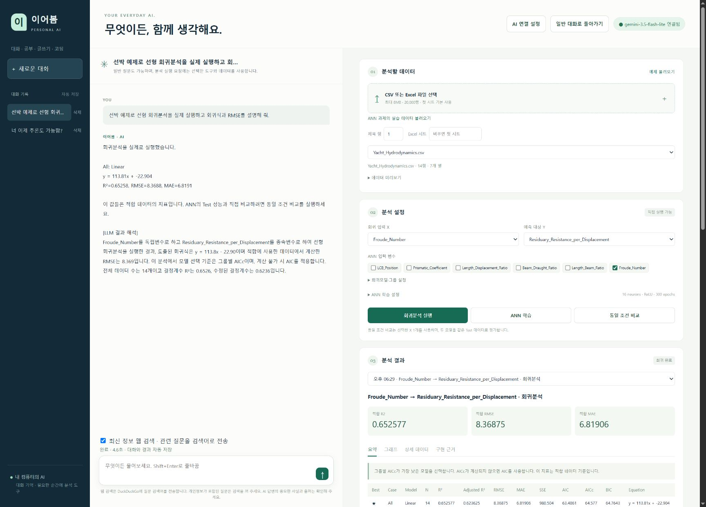
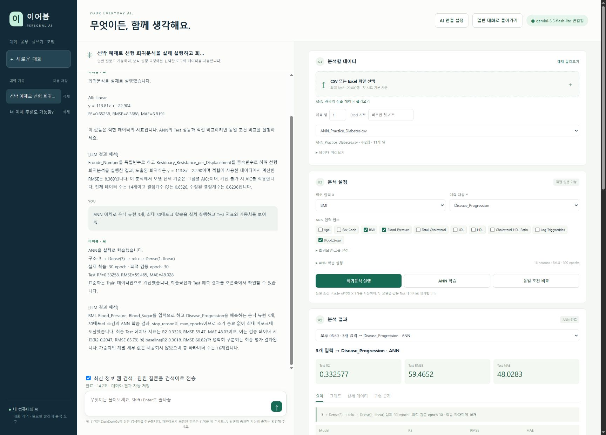
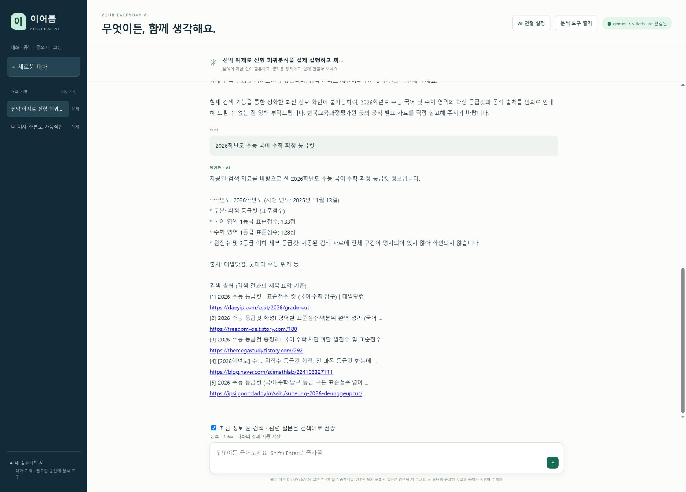
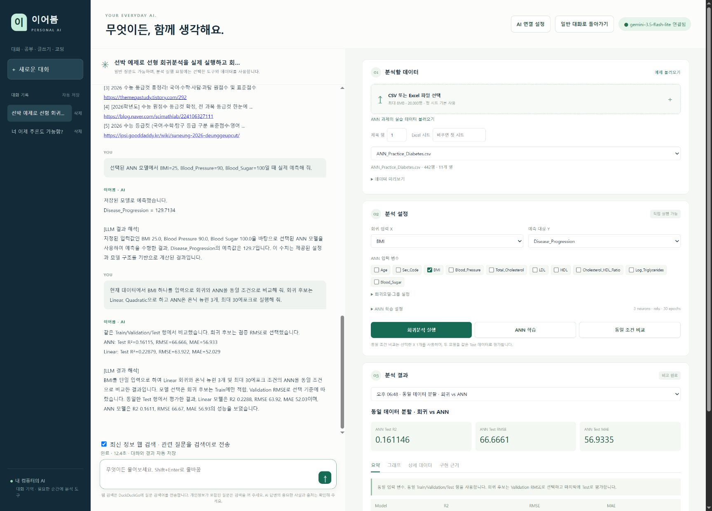

# 이어봄 AI 2.0 · 공개 API와 기존 과제 통합

기존 Qwen3.5 대화 기억 과제를 회귀분석·ANN·웹 검색과 연결한 최종 제출본입니다.

**[최종 프로그램 ZIP 다운로드](https://github.com/shy13460-maker/ieobom-llm-chat/raw/refs/heads/main/%EC%9D%B4%EC%96%B4%EB%B4%84_AI_v2.0_%ED%86%B5%ED%95%A9%EA%B3%BC%EC%A0%9CAI.zip)** · **[개발 과정과 모델 선택 보고서](REPORT_V2.md)**

## 실행

1. 위 최종 프로그램 ZIP을 내려받아 압축을 해제합니다.
2. 압축 안의 INSTALL.cmd를 실행합니다.
3. 같은 폴더의 START.cmd를 실행합니다.
4. AI 연결 설정에 본인 Google AI Studio 무료 프로젝트의 API 키를 입력합니다. 결제 활성화·카드 등록·유료 전환은 진행하지 않습니다.
5. 설정 저장 → 연결 시험 후 대화 또는 분석을 실행합니다.

API 키는 ZIP에 포함하지 않습니다. 교수님 PC에서도 해당 PC에서 키를 별도로 설정해야 합니다. 이미 키가 있으면 새로 발급할 필요는 없습니다. localhost는 설치한 PC에서만 접속하는 주소입니다.

## 과제 실행 예시

- 선박 예제로 선형 회귀분석을 실행해 줘.
- ANN 예제로 은닉 뉴런 3개, 최대 30에포크 학습해 줘.
- 현재 데이터에서 회귀와 ANN을 동일 조건으로 비교해 줘.
- 선택한 모델에 새 입력값을 넣어 실제 예측해 줘.

수치 계산은 기존 Python 과제 코드가 실제 수행하며, Gemini 3.5 Flash-Lite API는 요청 해석과 결과 설명을 담당합니다. 무료 웹 검색은 별도 프로그램 기능으로 검색 결과의 제목·요약·출처를 가져옵니다. 원문 전체나 모든 상세 표를 읽는 기능은 아닙니다.

## 기존 버전 보존

이 저장소 루트의 app.py, install.py, START_LOCAL.cmd, START_PUBLIC.cmd, web 및 REPORT.md는 이전 Qwen 로컬 구현을 보존한 것입니다. **2.0 실행은 루트의 구버전 실행 파일이 아니라, 위 최종 ZIP을 압축 해제한 폴더의 INSTALL.cmd·START.cmd를 사용합니다.** 최종 소스 전체와 기존 과제 원본 스냅샷, 테스트, 사용설명, 검증 기록은 최종 ZIP 안에 있습니다.

Qwen도 추론이 가능합니다. 변경 이유는 추론 불가능 여부가 아니라 로컬 모델 운영 부담과 범용 활용성을 고려한 설계 선택입니다. API 키는 인증 수단이며 웹 검색은 별도의 도구 연결입니다. 선택 과정과 503 오류 대응은 REPORT_V2.md에 기록했습니다.

## 검증

2026-11-23 실제 API 요청으로 회귀, ANN 학습, 저장 모델 예측, 동일 조건 비교, 검색과 출처 표시를 확인했습니다. 별도 검사 32개 통과, 기존 Qwen 실제 호출 검사 2개 제외이며 일부 API 검사에는 모의 응답을 사용했습니다. 자세한 근거와 한계는 ZIP의 VALIDATION.md를 참고하세요.

다른 물리적 PC의 설치 전체 과정과 외부 서비스의 장기 가용성을 보장하지 않습니다. 무료 API에는 호출 한도와 일시 장애가 있습니다. 프로그램은 키만으로 프로젝트의 결제 상태를 판별할 수 없으므로 결제가 연결되지 않은 무료 프로젝트인지 먼저 확인해야 합니다.

## 실제 실행 화면

## 연결한 기존 과제

- [선형·비선형 회귀분석](https://github.com/shy13460-maker/Regression-Analysis-Tool)
- [ANN Prediction Analyzer](https://github.com/shy13460-maker/ANN-Prediction-Analyzer)

API 키·개인 대화 DB·업로드 파일·로그·모델 가중치·개인 실행 환경은 제출물에 포함하지 않습니다.
